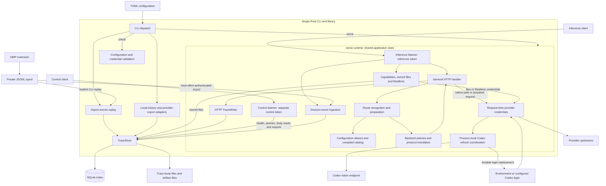

# Architecture

This map locates the implemented runtime boundaries for source review and bounded changes.

It does not report a new runtime check or approve a design change.
The [data flow](data-flow.md) explains capture and completion.
The [database schema](database-schema.md) explains stored records and logical relations.

The graph shows component dependencies and data access.
It does not make each box a separate process or service.
`serve` shares one `App` across two Axum listeners.
CLI imports and replay run through separate command invocations.
They open their own store handles against the configured directory.

Both listeners require authentication, including control health.
Their access tokens must differ.
The inference listener owns general HTTP, capabilities, files, Realtime, and session-event ingestion.
The control listener exposes metadata, bodies, artifacts, sessions, and exports.
Its responses carry `no-store` and `nosniff` headers.

The general handler selects native forwarding or a recognized route.
Model resolution uses exact aliases, configured namespaces, the compiled catalog, then the default provider for unknown IDs.
Route preparation checks backend capabilities and applies supported protocol conversion.
Backend implementations are static Rust objects.

Provider credentials resolve at request time.
Modes include no credentials, environment credentials, passthrough credentials, and a configured Codex login.
Codex refresh coordinates access by resolved credential path within one process.
Refresh can replace the login durably after token rotation.
This lock does not coordinate independent processes.

`TraceStore` combines SQLite records with filesystem bodies and artifacts.
Store clones in one runtime share a mutex-protected SQL connection.
SQL operations use blocking workers.
The [database schema](database-schema.md) distinguishes SQL constraints from logical references.
The diagram does not imply foreign keys between every related record.

Stored header metadata redacts classified sensitive headers.
Raw bodies, artifacts, session payloads, and the OMP spool remain sensitive.
OMP writes and syncs each captured event before an attempted upload.
Successful uploads remain in the spool.
Hook failures can leave missing events.

Source anchors:

- [CLI dispatch](../src/main.rs): `main`, `selection_options`.
- [Listeners and handlers](../src/proxy.rs): `serve`, `authenticate`, `inference`, `realtime`, `ingest_session_event`, `control_no_cache`.
- [Model resolution](../src/config.rs): `Config::resolve_model`; [catalog](../src/catalog.rs).
- [Route preparation](../src/route.rs): `Route::recognize`, `Route::prepare`; [backend selection](../src/backend.rs): `get`.
- [Translation](../src/translate.rs) and [stream translation](../src/translate/stream.rs).
- [Credentials](../src/auth.rs): `ProviderAuth::headers`, `codex_headers`, `lock_snapshot`, `refresh_and_resolve`.
- [Store](../src/trace.rs): `TraceStore::open`, `blocking`, `start`, `put_event`, `put_import_snapshot`.
- [Local imports](../src/import.rs), [provider exports](../src/provider_export.rs), and [OMP capture](../integrations/omp/infer-traces.ts).

For development checks, see [development conventions](../CONVENTIONS.md).
