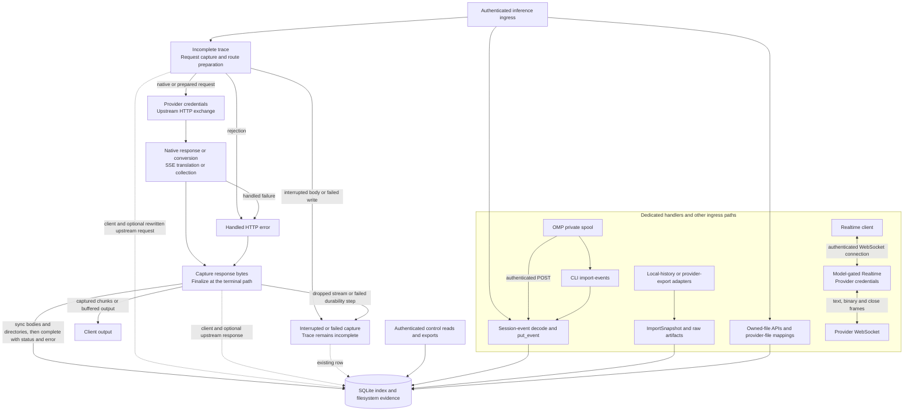

# Data flow

This map identifies captured bytes, completion boundaries, and ingress paths that bypass ordinary HTTP tracing.

It does not report a new runtime check.
The [architecture](architecture.md) locates components.
The [database schema](database-schema.md) identifies records and logical relations.

Solid arrows show control or data flow.
Dotted arrows show captured evidence.
The diagram separates dedicated ingress from the general HTTP trace path.
Capabilities also use a dedicated handler and return configuration-derived data without a `TraceWriter`.

Authentication and some path checks precede trace creation.
Rejected access and unsupported paths therefore do not always create a trace.
The general handler inserts an incomplete row before it creates body files.
Accepted request chunks enter the client request file before forwarding or preparation.
Native forwarding streams the body.
Recognized routes buffer within their configured request limit before parsing.

Route preparation resolves model and backend policies.
It can rewrite aliases, convert protocols, or replace owned-file references with provider IDs.
The writer stores a separate upstream request when preparation marks the request rewritten.
`send` records resolved route metadata before the upstream request.
Header filtering removes gateway credentials and hop-by-hop headers from forwarding.
Configured provider authentication supplies outgoing credentials.

Response handling selects native forwarding, complete-response conversion, SSE translation, or SSE collection.
Forced upstream streaming can require collection for a non-streaming client.
Recorded client and upstream bodies can differ.
Separate upstream body files exist only when that response path requires them.
Native general HTTP forwarding does not inherit routed buffering limits.

Each successful append flushes its file before the corresponding body chunk proceeds.
Finalization syncs body files and directories before SQLite advertises completion.
Bodyless responses finalize before the handler returns.
Streamed responses finalize as their body stream reaches its terminal path.
An interrupted or failed writer cannot claim completion.
A dropped body stream can leave the trace incomplete.
Some handled errors finalize a trace with an error and an HTTP status.
Thus, `complete` identifies finalized capture rather than successful inference.

Stored request and response header metadata redacts classified sensitive headers.
Raw body files remain unredacted.
Session payloads, imported snapshots, artifacts, and OMP spools also remain sensitive.
Control authentication protects reads and exports.
The storage design does not imply encryption at rest or a retention quota.

Dedicated ingress paths:

- Session-event POST decodes an event and calls `put_event` without an inference trace writer.
- CLI replay decodes spool lines and calls the same store operation. It does not POST through the listener.
- OMP syncs a private spool before best-effort POST. Successful sends remain available for replay.
- Local and provider adapters persist `ImportSnapshot` records and artifact provenance. Imported observations do not invent inference trace correlations.
- Owned-file handlers use artifact bytes and file mappings. Routed requests can upload these files to a selected provider.
- Realtime validates model support, resolves credentials, and forwards WebSocket frames in independently polled directions. It bypasses the general HTTP `TraceWriter`.

SQLite and filesystem publication follow explicit ordering.
They do not form one atomic transaction across both storage systems.
The [database schema](database-schema.md) distinguishes enforced constraints from logical links.

Source anchors:

- [HTTP flow](../src/proxy.rs): `inference`, `send`, `respond`, `reject`, `finish`, `swap_infer_files`.
- [Trace lifecycle](../src/trace.rs): `TraceStore::start`, `TraceWriter::append`, `TraceWriter::finish`.
- [Dedicated paths](../src/proxy.rs): `realtime`, `proxy_realtime`, `ingest_session_event`, `create_file`.
- [CLI replay](../src/main.rs): `Command::ImportEvents`; [imports](../src/import.rs): `import_sources`.
- [Provider exports](../src/provider_export.rs): `import_sources`; [store ingress](../src/trace.rs): `put_event`, `put_import_snapshot`, `put_import_artifact`.
- [OMP spool and upload](../integrations/omp/infer-traces.ts): `append`, `upload`, `capture`.

For development checks, see [development conventions](../CONVENTIONS.md).
