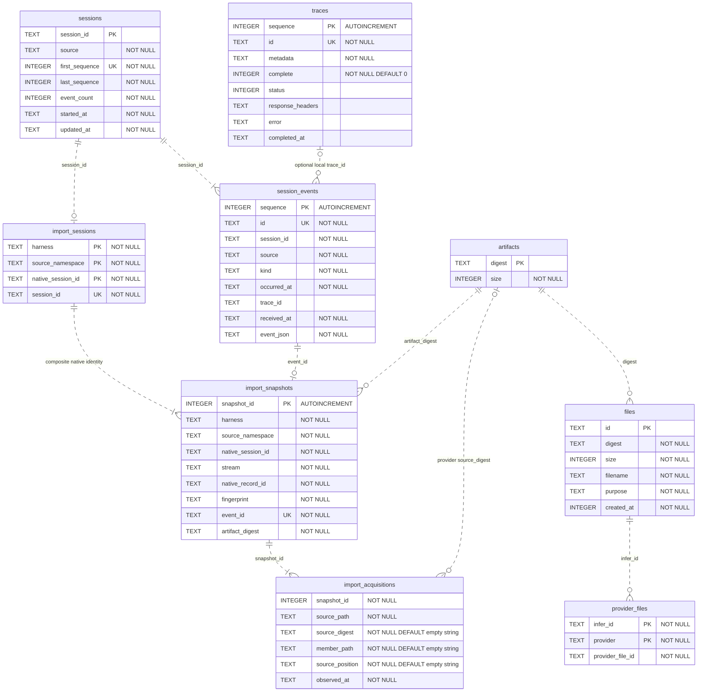

# Database schema

This guide defines the SQLite v4 storage contract for inspection, import adapters, and maintenance work.
The authority is [`TraceStore::open`](../src/trace.rs), together with its write and query paths.
This is a source-derived description, not a claim about an existing production database.

Related guides: [architecture](architecture.md), [data flow](data-flow.md).

## Tables and relationships

The index contains nine application tables.
SQLite also maintains `sqlite_sequence` for the three `AUTOINCREMENT` keys.
The diagram lists every application column and its declared SQLite type.
`PK` marks a primary-key member. `UK` marks a single-column unique constraint.
Composite unique constraints appear after the diagram.

Every relationship is logical and maintained by application code.
The DDL declares no foreign keys, triggers, or delete cascades.
The dashed lines do not imply database enforcement.



### Constraints and indexes

The diagram copies explicit `NOT NULL` declarations.
The ordinary rowid tables do not explicitly declare `sessions.session_id`, `artifacts.digest`, or `files.id` as `NOT NULL`.
Their `TEXT PRIMARY KEY` declarations do not add that constraint in SQLite.
The application supplies these identifiers on its write paths.
The integer primary keys alias SQLite rowids.

The composite primary keys are `(harness, source_namespace, native_session_id)` in `import_sessions` and `(infer_id, provider)` in `provider_files`.
`import_acquisitions` has no explicit primary key.
Its implicit rowid is not an application identifier.

The composite unique constraints are:

- `import_snapshots(harness, source_namespace, native_session_id, stream, native_record_id, fingerprint)`.
- `import_acquisitions(snapshot_id, source_path, source_digest, member_path, source_position)`.

`traces.complete` has `CHECK (complete IN (0, 1))` and defaults to `0`.
The three acquisition fields `source_digest`, `member_path`, and `source_position` default to `''`.
Empty strings represent absent provenance values.
The DDL has no JSON-validity checks or other value checks.

The named indexes are nonunique:

| Index | Ordered columns |
|---|---|
| `session_events_session_sequence` | `session_id, sequence` |
| `session_events_session_trace` | `session_id, trace_id` |
| `import_snapshots_logical_identity` | `harness, source_namespace, native_session_id, stream, native_record_id` |

SQLite creates implicit indexes for the other primary-key and unique constraints.

### Application contracts

Event insertion and session-summary updates share one SQLite transaction.
`sessions.source` retains the first event's source.
`first_sequence` and `last_sequence` identify the first and latest events in ingestion order.
`started_at` and `updated_at` contain server receipt times, not native historical session times.

`session_events.trace_id` can refer to a trace absent from this store.
Session trace queries return only distinct traces that exist locally.
Neither the event relation nor an event kind marks a trace complete or successful.

An import session maps a harness, source namespace, and native session ID to one generated session ID.
Each new snapshot creates one immutable event, a snapshot row, and an acquisition receipt in the same transaction.
Its `fingerprint` and `artifact_digest` both contain the SHA-256 digest of the snapshot bytes.
Unchanged native records reuse the event. Changed bytes append a revision under the same logical identity.
Replay can add acquisition receipts without changing the immutable event.

A nonempty provider acquisition `source_digest` identifies the separately retained original JSON or ZIP artifact.
Local and legacy receipts can contain an empty source digest.
Provider conversation snapshots contain serialized native JSON. The source artifact preserves the original file bytes.
Local JSONL artifacts preserve record bytes without LF or CRLF delimiters.
SQLite imports retain typed JSON row projections, not database pages.
The adapters are [`import.rs`](../src/import.rs) and [`provider_export.rs`](../src/provider_export.rs).

An owned file references artifact bytes through `files.digest`.
`files.created_at` contains Unix seconds. Trace and event times use text timestamps.
`provider_files` caches one upstream file ID per owned file and provider.
The database does not enforce that the provider still exists in configuration.

## Filesystem storage and lifecycle

`trace_dir/index.sqlite3` contains the index, not the body or artifact bytes.
The store requires WAL journaling and `synchronous=FULL`.
It sets a five-second busy timeout and serializes work through one connection per shared store.
SQLite work runs on blocking workers.
Unix storage directories use mode `0700`. The database, sidecars, bodies, and artifacts use mode `0600`.
The store rejects symlink destinations at its checked storage boundaries.

| External data | Location |
|---|---|
| Trace bodies | `trace_dir/TRACE_UUID/request.body` and `response.body` |
| Upstream body views, created on demand | `trace_dir/TRACE_UUID/upstream_request.body` and `upstream_response.body` |
| Content-addressed artifacts | `trace_dir/artifacts/sha256/DIGEST_FIRST_2/DIGEST` |
| SQLite sidecars | `trace_dir/index.sqlite3-wal`, `index.sqlite3-shm`, and `index.sqlite3-journal` when present |
| OMP event spool, default | `~/.omp/agent/infer-spool/SESSION_ID.CAPTURE_UUID.jsonl` |

The [OMP extension](../integrations/omp/infer-traces.ts) uses `INFER_TRACE_SPOOL_DIR` to override its spool directory.
It appends and syncs each event before upload. Successful uploads remain in the spool.

A trace starts with a durable incomplete index row before body-file creation.
Completion syncs the body files and directory entries before the metadata update.
Cancellation, interruption, or a storage failure does not publish successful completion.
An incomplete body can contain only the recorded prefix.

Artifact publication precedes the metadata transaction.
A later failure can leave artifact bytes without a matching index row.
Deleting an owned file removes its provider mappings and file row.
It retains the artifact row and artifact bytes.
The store declares no artifact garbage collection, trace deletion endpoint, or automatic retention.
Admission and export limits do not impose a lifetime disk quota.

Raw bodies, artifacts, events, and spool files can contain sensitive content.
Header redaction does not redact their content or encrypt local storage.

## Schema versions

The store rejects `PRAGMA user_version` values greater than `4`.
It creates missing tables and indexes with the current DDL.
For versions less than `4`, except version `3`, it then sets `user_version` to `4`.
It does not rebuild arbitrary existing tables to match that DDL.

Version `3` has a dedicated receipt migration.
The migration rebuilds `import_acquisitions` and preserves its source paths and observation times.
Only the first receipt by rowid for each snapshot qualifies for position recovery.
When its observation time matches the immutable event's receipt time, the migration recovers the position from that event.
Other legacy positions remain unknown. Source digests and member paths use their empty defaults.
The migration leaves events and snapshots unchanged, drops the old receipt table, and commits schema version `4`.

## Verification procedure

Run this command from the repository root:

```sh
python3 - <<'PY'
from pathlib import Path
import re
import sqlite3

source = Path('src/trace.rs').read_text()
guide = Path('docs/database-schema.md').read_text()
ddl = re.search(r'"BEGIN IMMEDIATE;(.*?)COMMIT;",', source, re.S).group(1)
db = sqlite3.connect(':memory:')
db.executescript(ddl)
tables = {row[0] for row in db.execute(
    "SELECT name FROM sqlite_schema WHERE type='table' AND name!='sqlite_sequence'"
)}
assert len(tables) == 9
entities = dict(re.findall(r'^    (\w+) \{\n(.*?)^    \}', guide, re.M | re.S))
assert set(entities) == tables
for table in sorted(tables):
    actual = [(row[1], row[2]) for row in db.execute(f'PRAGMA table_info({table})')]
    documented = [(name, kind) for kind, name in re.findall(
        r'^        (INTEGER|TEXT) (\w+)', entities[table], re.M
    )]
    assert documented == actual, (table, documented, actual)
    assert not list(db.execute(f'PRAGMA foreign_key_list({table})'))
    print(table, actual)
for name, sql in db.execute(
    "SELECT name, sql FROM sqlite_schema WHERE type='index' AND sql IS NOT NULL"
):
    print(name, sql)
print('PASS: nine diagram entities match source DDL columns/types with no foreign keys')
PY
```

This command executes the source DDL only in memory. It does not open a history store or exercise runtime durability.
Compare diagram key labels and relationship prose with the DDL and write paths after each storage change.
